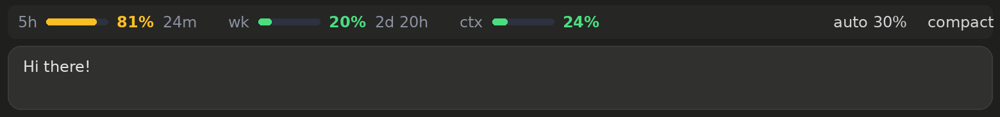
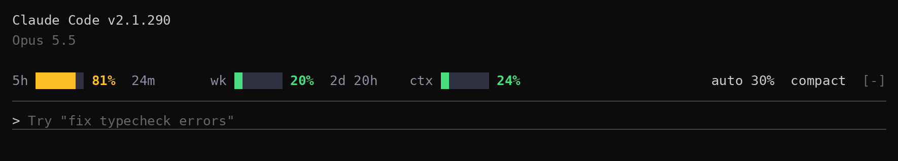

# usage-quota-mini

A one-row usage bar above the Claude Code prompt. Slim fork of
[anantraghunath/claude-code-usage-quota-mod](https://github.com/anantraghunath/claude-code-usage-quota-mod):
same data engine (live plan limits, pace forecast, exact context count, auto compact),
with the UI cut down to a single line.

| Desktop | Terminal |
| --- | --- |
|  |  |

Previews are mock-ups.

```
5h ▬▬▬▬▬▬ 81% 24m     wk ▬▬▬▬▬▬ 20% 2d 20h     ctx ▬▬▬▬▬▬ 24%          auto 30%  compact
```

## What it shows

- **5h / wk**: % used of the 5 hour and weekly limits (whole account), and time to reset.
  Green, amber from 75%, red from 90%, or sooner if the forecast says you will run out.
  When on course to run out the countdown becomes `out 1h 14m`; at the limit, `back 14:30`.
- **ctx**: context window % used. Amber from 50%, red from 80%. Hover the bar for tokens.
- **auto**: click to step auto compact through off, 30%, 50%, 70%, off. Per session, as in the original.
  If the context is already past the new %, the controls are replaced by `compact now` / `after next`.
- **compact**: runs `/compact`.

Narrow chats drop the bars first (below 80 columns), then the countdowns (below 52).

Removed versus the original: the headline, the expanded view and its collapse arrow,
the context breakdown, the forecast tick, the auto compact switch and % field.

`/quota` toggles the bar.

## Install

Uninstall the original first, so the two bars don't stack:

```text
/plugin uninstall usage-quota@claude-code-usage-quota-mod
```

Then, inside `claude`:

```text
/plugin marketplace add papamzor/usage-quota-mini
```

```text
/plugin install usage-quota-mini@usage-quota-mini
```

```text
/reload-plugins
```

**Desktop app:** in the Code tab, send this as a message, then quit and reopen the app:

```text
Install the usage-quota-mini plugin from the GitHub marketplace papamzor/usage-quota-mini
```

Needs Claude Code 2.1.287 or later with a Pro or Max login, same as the original.

## Tests

`tests/bar.test.tsx` uses Claude Code's `claude-code/testing` harness. Run `/plugin-types`
first to write the local API types into `.claude-plugin/types/`.

## License

MIT. Original work by Anant Raghunath.
